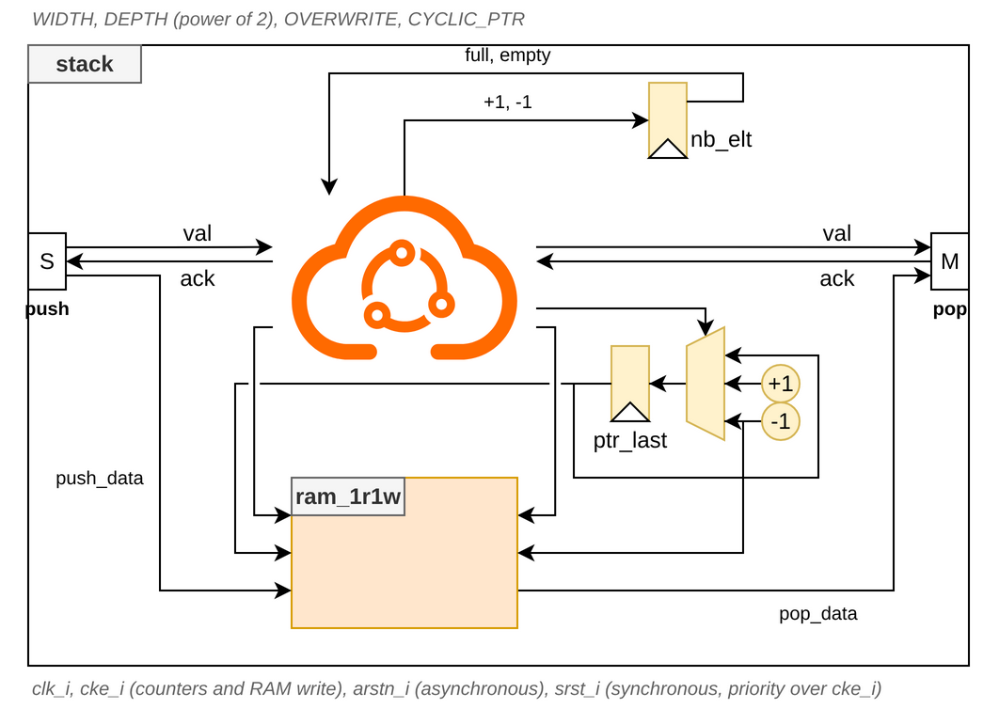
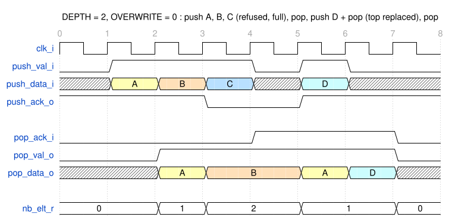

<!--
  README MODEL (common to every Asylum IP, keep the same headings)
  ----------------------------------------------------------------
  Regenerate from the sources, never from the previous README text alone:
    hdl/*.vhd (entities, generics, ports), hdl/csr/*.hjson (register map),
    <IP>.core (VLNV, targets, depends), mk/targets.txt, sim/, syn/, esw/.
  Sections, in this order:
    badges / title + one-line pitch / Overview / Features / Block Diagram /
    Getting Started / Hardware Interfaces / Configuration / Resources /
    Theory of Operation / Registers / Programmer's Guide /
    Design Verification / Dependencies and Related IPs / License
  Rules:
    - English, short and factual: every statement backed by the sources.
    - No VLNV line: the version badge shows it.
    - Badges: first line version, license; second line CI, lint, sim, syn.
    - Block diagram and FSM: pages Overview and FSM of doc/<NAME>.drawio, exported to
      doc/<NAME>-Overview.png and doc/<NAME>-FSM.png (make -C doc).
    - Timing diagrams: WaveDrom source doc/<NAME>-<what>.json, rendered
      doc/<NAME>-<what>.svg (make -C doc), shown as images.
    - No CPU named (OpenBlaze, PicoBlaze, RISC-V) outside the CPU and SoC IPs.
    - Registers: link to the generated hdl/csr/<X>_csr.md, never copy the tables.
    - Tables: Configuration = Name|Type|Default|Description,
      Hardware Interfaces = Name|Direction|Type|Description, grouped by interface.
    - A section with nothing to say is one line ("This IP has no
      software-visible registers."), never removed.
-->
[](https://github.com/deuskane/asylum-component-stack/tags)
[](LICENSE)

[](https://github.com/deuskane/asylum-component-stack/actions/workflows/ci.yml)
[](https://github.com/deuskane/asylum-component-stack/actions/workflows/ci.yml)
[](https://github.com/deuskane/asylum-component-stack/actions/workflows/ci.yml)
[](https://github.com/deuskane/asylum-component-stack/actions/workflows/ci.yml)

# Stack

**A small, readable hardware stack (LIFO) in VHDL: valid / acknowledge push and pop, top word always visible, optional overwrite when full and cyclic pointer.**

Part of the [Asylum project](https://github.com/deuskane/asylum-project), a collection of small IP cores, written to be read and learned from.

## Table of Contents

1. [Overview](#overview)
2. [Features](#features)
3. [Block Diagram](#block-diagram)
4. [Getting Started](#getting-started)
5. [Hardware Interfaces](#hardware-interfaces)
6. [Configuration](#configuration)
7. [Resources](#resources)
8. [Theory of Operation](#theory-of-operation)
9. [Registers](#registers)
10. [Programmer's Guide](#programmers-guide)
11. [Design Verification](#design-verification)
12. [Dependencies and Related IPs](#dependencies-and-related-ips)
13. [License](#license)

## Overview

This IP is a last in, first out memory: the last word pushed is the first one popped. A typical use is the return-address stack of a processor (a call pushes the return address, a return pops it).

The words are stored in a `ram_1r1w` with an asynchronous read (core `asylum:component:ram`). A pointer gives the next free slot of the RAM and a counter the number of words: the top word is always on `pop_data_o` while the stack is not empty, and the stack tells whether it can accept a push (`push_ack_o`) and whether it holds a word (`pop_val_o`).

## Features

- Word width (`WIDTH`) and depth (`DEPTH`, power of 2) set by generics
- Push interface `push_val_i` / `push_ack_o` / `push_data_i`, pop interface `pop_val_o` / `pop_ack_i` / `pop_data_o`
- Top of stack on `pop_data_o` without latency (asynchronous RAM read)
- Push and pop in the same cycle: the top word is replaced
- Full stack: push refused (default) or accepted, the oldest word being overwritten (`OVERWRITE /= 0`)
- Cyclic pointer (`CYCLIC_PTR`): a pop on an empty stack still moves the pointer, the next pop reads the word below
- Clock enable `cke_i`, asynchronous reset `arstn_i` and synchronous reset `srst_i`, usable together

## Block Diagram



The control logic (orange cloud) turns the handshakes into the `push` and `pop` events, from the `full` and `empty` flags of the level counter `nb_elt`. The pointer `ptr_last` moves by +1 on a push and by -1 on a pop; the RAM is read at `ptr_last-1` (top of stack) and written at `ptr_last` (push) or at `ptr_last-1` (push and pop in the same cycle).

## Getting Started

The cores of the Asylum IPs are published in the FuseSoC library [asylum-cores](https://github.com/deuskane/asylum-cores) (with the UVVM core used by the testbenches):

```bash
pip install fusesoc
fusesoc library add https://github.com/deuskane/asylum-cores
fusesoc run --target sim_cyclic_lifo asylum:component:stack  # needs GHDL
```

To use the IP in your design, add `asylum:component:stack` to the `depend` list of your core and instantiate `stack` (library `asylum`):

```vhdl
library asylum;
use     asylum.stack_pkg.all;

  ins_stack : stack
    generic map
    ( WIDTH       => 10
     ,DEPTH       => 16
     ,OVERWRITE   => 1               -- a push on a full stack drops the oldest word
     ,CYCLIC_PTR  => false
    )
    port map
    ( clk_i       => clk
     ,cke_i       => '1'
     ,arstn_i     => arst_b
     ,srst_i      => '0'
     ,push_val_i  => call
     ,push_ack_o  => open            -- always '1' with OVERWRITE /= 0
     ,push_data_i => return_address  -- std_logic_vector(9 downto 0)
     ,pop_val_o   => stack_not_empty
     ,pop_ack_i   => ret
     ,pop_data_o  => top_address     -- std_logic_vector(9 downto 0)
    );
```

## Hardware Interfaces

Top-level entity: **`stack`** ([hdl/stack.vhd](hdl/stack.vhd)), component in `asylum.stack_pkg` ([hdl/stack_pkg.vhd](hdl/stack_pkg.vhd)).

### Clock and Reset

| Name | Direction | Type | Description |
|------|-----------|------|-------------|
| `clk_i` | in | std_logic | Clock, the only clock of the IP |
| `cke_i` | in | std_logic | Clock enable, active high: the counter, the pointer and the RAM write only change when `cke_i = 1` |
| `arstn_i` | in | std_logic | Asynchronous reset, active low: empty stack at once, whatever `clk_i` and `cke_i` |
| `srst_i` | in | std_logic | Synchronous reset, active high, default `'0'`: empty stack after the rising edge of `clk_i`, whatever `cke_i` |

### Push

| Name | Direction | Type | Description |
|------|-----------|------|-------------|
| `push_val_i` | in | std_logic | Push request |
| `push_ack_o` | out | std_logic | Push accepted: `not full`, always `'1'` with `OVERWRITE /= 0` |
| `push_data_i` | in | std_logic_vector(WIDTH-1 downto 0) | Word to push |

### Pop

| Name | Direction | Type | Description |
|------|-----------|------|-------------|
| `pop_val_o` | out | std_logic | Stack not empty: `pop_data_o` is the top word |
| `pop_ack_i` | in | std_logic | Pop request: the top word is removed on the rising edge when `pop_val_o = 1` (see `CYCLIC_PTR`) |
| `pop_data_o` | out | std_logic_vector(WIDTH-1 downto 0) | Top of stack (asynchronous RAM read at `ptr_last_r-1`) |

## Configuration

| Name | Type | Default | Description |
|------|------|---------|-------------|
| `WIDTH` | natural | `32` | Word width in bits |
| `DEPTH` | natural | `4` | Number of words, a power of 2 (the pointer wraps modulo `2**log2(DEPTH)`, `ram_1r1w` reports an error in simulation otherwise) |
| `OVERWRITE` | natural | `0` | `0`: a push on a full stack is refused (`push_ack_o = 0`); `/= 0`: it is accepted and overwrites the oldest word |
| `CYCLIC_PTR` | boolean | `false` | `true`: a pop on an empty stack (without push in the same cycle) still moves the pointer back, the next pop reads the word below; needs `OVERWRITE /= 0` (assertion failure otherwise). `false`: a pop on an empty stack is ignored |

## Resources

Figures of the `syn_*` targets (`make nonreg_syn`, see [Targets](#targets)): `stack` with the generics of each configuration, synthesized by Yosys and its GHDL plugin; the reports are in the build directory of each target.

| Configuration | LUT¹ | LUTRAM¹ | FF¹ | CARRY4¹ | MUXF7/F8¹ | BRAM¹ | DSP¹ | Area² (µm²) | kGE³ |
|---|---|---|---|---|---|---|---|---|---|
| `syn_default` (4 x 32 bits) | 22 | 24 | 5 | 1 | 6 | 0 | 0 | 5079.87 | 1.353 |
| `syn_8x8b` (8 x 8 bits) | 24 | 8 | 7 | 3 | 0 | 0 | 0 | 2914.04 | 0.776 |
| `syn_4x16b_overwrite` (4 x 16 bits, `OVERWRITE = 1`) | 23 | 12 | 5 | 1 | 6 | 0 | 0 | 2712.60 | 0.723 |
| `syn_32x10b` (32 x 10 bits, `OVERWRITE = 1`) | 34 | 8 | 11 | 6 | 1 | 0 | 0 | 12948.67 | 3.450 |
| `syn_cyclic` (32 x 10 bits, `OVERWRITE = 1`, `CYCLIC_PTR = true`) | 33 | 8 | 11 | 6 | 3 | 0 | 0 | 12976.20 | 3.457 |

¹ Xilinx Artix-7 (LUT6), Yosys 0.33 `synth_xilinx -flatten -noiopad -noclkbuf`, before place and route: every cell of the netlist is counted, Vivado may differ. Identical cells are merged as a vendor tool does (`opt_merge -share_all`): the inverters of an active-low reset net become one; every remaining cell is counted, an `INV` as a `LUT1` (4 of the 22 LUTs of `syn_default`, 6 of 24 for `syn_8x8b`, 4 of 23 for `syn_4x16b_overwrite`, 8 of 34 for `syn_32x10b`, 8 of 33 for `syn_cyclic`). The words are in distributed RAM (`RAM32M`, 4 LUTRAM each): the RAM has an asynchronous read, which a block RAM does not have, so there is never a BRAM. Flip-flops: the level counter (`log2(DEPTH)+1` bits) and the pointer (`log2(DEPTH)` bits) only.

² SkyWater sky130 `sky130_fd_sc_hd`, typical corner (tt, 25 °C, 1.80 V), Yosys 0.33 `synth` + `dfflibmap` + `abc -liberty`: standard-cell area only, no timing constraint, no buffering, clock tree or placement. There is no SRAM macro: the `WIDTH x DEPTH` bits of the RAM become flip-flops and most of the area.

³ Area in thousands of NAND2 gate equivalents (`sky130_fd_sc_hd__nand2_1` = 3.7536 µm²).

## Theory of Operation

### Hierarchy

| File | Unit | Role |
|------|------|------|
| [hdl/stack.vhd](hdl/stack.vhd) | `stack` | Level counter `nb_elt_r`, pointer `ptr_last_r`, flags, RAM addresses, `ram_1r1w` instance |
| [hdl/stack_pkg.vhd](hdl/stack_pkg.vhd) | `stack_pkg` | Component `stack` |

The storage is the `ram_1r1w` entity of `asylum:component:ram`, with `SYNC_READ = false`.

### Counter, pointer and flags

- `nb_elt_r` (`log2(DEPTH)+1` bits) is the number of words: `full` is its MSB (`nb_elt_r = DEPTH`), `empty` is `nb_elt_r = 0`.
- `ptr_last_r` (`log2(DEPTH)` bits) is the next free slot of the RAM; the top word is at `ptr_last_r-1`. The pointer wraps modulo `DEPTH`, the counter does not (it stays between 0 and `DEPTH`).
- `push_ack_o = not full` (`'1'` with `OVERWRITE /= 0`), `pop_val_o = not empty`.
- `push = push_val_i and push_ack_o`; `pop = pop_ack_i and pop_val_o` (with `CYCLIC_PTR`: `pop_ack_i and (pop_val_o or not push_val_i)`).

On the rising edge of `clk_i`, with `cke_i = 1` and no reset:

| `push` | `pop` | `nb_elt_r` | `ptr_last_r` | RAM write |
|--------|-------|------------|--------------|-----------|
| 0 | 0 | unchanged | unchanged | none |
| 1 | 0 | +1 (unchanged if full) | +1 | `push_data_i` at `ptr_last_r` |
| 0 | 1 | -1 (unchanged if empty, `CYCLIC_PTR` only) | -1 | none |
| 1 | 1 | unchanged | unchanged | `push_data_i` at `ptr_last_r-1` (top replaced) |



- `pop_data_o` shows the top word before the clock edge of the pop; the word below appears after the edge.
- Full stack with `OVERWRITE /= 0`: a push keeps `nb_elt_r` at `DEPTH` and moves `ptr_last_r` onto the oldest word, which is overwritten: the stack keeps the last `DEPTH` words pushed.
- `CYCLIC_PTR = true`: a pop on an empty stack (without push) moves `ptr_last_r` back, `nb_elt_r` stays at 0 and `pop_val_o` at 0: the pointer is purely cyclic, the next pop shows the word below in the RAM. With `CYCLIC_PTR = false` such a pop is ignored.

### Resets and clock enable

- `arstn_i = 0` clears `nb_elt_r` and `ptr_last_r` at once, whatever `clk_i` and `cke_i`.
- `srst_i = 1` clears them on the rising edge of `clk_i`, whatever `cke_i`, and wins over a push or a pop of the same cycle.
- `cke_i = 0` freezes `nb_elt_r`, `ptr_last_r` and the RAM.
- The RAM content is not reset. A push requested during a reset with `cke_i = 1` still writes the RAM (the word is not in the stack after the reset); it is only visible with `CYCLIC_PTR`, when pops on the empty stack read the RAM.

## Registers

This IP has no software-visible registers.

## Programmer's Guide

This IP has no software interface: it is driven by hardware through its push and pop handshakes.

## Design Verification

### Testbench

| File | DUT | Description |
|------|-----|-------------|
| [sim/stack/tb_stack.vhd](sim/stack/tb_stack.vhd) | `stack` | Self-checking UVVM testbench, generics `TESTS_LIST` (scenarios, see below), `WIDTH`, `DEPTH`, `OVERWRITE`, `CYCLIC_PTR`. Every cycle, the inputs are driven on the falling edge of the clock and, a quarter period later, `pop_val_o`, `push_ack_o` and `pop_data_o` (when the stack is not empty) are compared with a reference model of the stack content |

The cycle procedure, the reference model and the reset pulse are in [tb_stack_bfm_pkg](sim/stack/tb_stack_bfm_pkg.vhd); one package per scenario (`tb_stack_<name>_pkg`); names, applicability and dispatch in [tb_stack_tests_pkg](sim/stack/tb_stack_tests_pkg.vhd). The pushed words toggle every bit (`i`, inverted every other pair of words) and each scenario of a list pushes other words than the previous one: the RAM is not reset, a missing write can not read back an equal word.

### Scenarios (`TESTS_LIST`)

The scenarios are chosen at run time with the generic `TESTS_LIST`: names separated by `,` without space (`lifo,push_full,lifo`), a name may be repeated. The sequencer first checks every name (an unknown name, or `cyclic` with `CYCLIC_PTR = false`, is a `TB_ERROR` before any scenario runs), then for each scenario drives a reset pulse with the inputs idle, logs `TEST <i>/<N> : <name>` and runs it: each scenario starts from reset. The empty list (default) only compiles and elaborates the testbench. The list is parsed and its names checked with `list_length` / `list_item` / `list_contains` of `asylum.string_pkg` (`asylum:utils:pkg` >= 1.10.0).

Checks counted as the `=> OK` lines of the log, reference configuration (`WIDTH = 10`, `DEPTH = 8`, `OVERWRITE = 1`, `CYCLIC_PTR = true`):

| Name | Checks | Description |
|------|--------|-------------|
| `reset_values` | 4 | Outputs during the reset and after it: empty stack, push accepted |
| `lifo` | 49 | Push up to full, then pop in LIFO order: `pop_data_o` is the last word pushed at every level |
| `push_full` | 58 | `DEPTH+3` pushes on a full stack: refused with `OVERWRITE = 0` (content kept), accepted with `OVERWRITE /= 0` (the stack keeps the last `DEPTH` words) |
| `push_pop` | 381 | Push and pop in the same cycle at every level 0 to `DEPTH` (reset before each level): top word replaced; push only on an empty stack; pop only on a full stack with `OVERWRITE = 0` |
| `cke` | 70 | `cke_i = 0` freezes the stack: push, pop and push+pop ignored, half full and full |
| `async_reset` | 88 | `arstn_i` on a full stack: empty (and push accepted) before the next clock edge and after it; also with `cke_i = 0` and a push+pop request; stack usable after it |
| `random` | 3409 | 1200 cycles of random push, pop and `cke_i` in three phases (towards full, towards empty, balanced), own seeds; with `CYCLIC_PTR`, no pop on an empty stack |
| `cyclic` | 128 | `CYCLIC_PTR` only: `DEPTH+1` pushes, `DEPTH+3` pops (3 on the empty stack), 2 pushes, 4 pops, against a circular model of the RAM; then `srst_i`, and later `arstn_i`, put the pointer back to 0: the pops on the empty stack read the RAM from its last word down |
| `sync_reset` | 89 | `srst_i` on a full stack: stack kept until the clock edge, then empty even with `cke_i = 0`; `srst_i` wins over a push+pop request; stack usable after it |

The other configurations run the whole list except `cyclic`: `sim_basic` 4143 checks, `sim_overwrite` 3734 checks.

The testbench was validated with 30 mutants of [hdl/stack.vhd](hdl/stack.vhd) (flags, handshakes, counter and pointer updates, resets and clock enable priorities, RAM addresses, write enable and data bits, cyclic pointer), each scenario run alone in each configuration: every mutant is killed.

### Targets

| Target | Toplevel | Description |
|--------|----------|-------------|
| `default` | `stack` | HDL fileset (not a simulation) |
| `sim_cyclic` | `tb_stack` | Reference configuration (`WIDTH = 10`, `DEPTH = 8`, `OVERWRITE = 1`, `CYCLIC_PTR = true`): build and elaboration only (`TESTS_LIST` empty), base of the scenario targets and of the list runs |
| `sim_cyclic_<name>` | `tb_stack` | One target per scenario: `sim_cyclic_reset_values`, `_lifo`, `_push_full`, `_push_pop`, `_cke`, `_async_reset`, `_random`, `_cyclic`, `_sync_reset` (4276 checks in all) |
| `sim_basic` | `tb_stack` | `WIDTH = 8`, `DEPTH = 8`, `OVERWRITE = 0`: every scenario except `cyclic` (4143 checks) |
| `sim_overwrite` | `tb_stack` | `WIDTH = 16`, `DEPTH = 4`, `OVERWRITE = 1`: every scenario except `cyclic` (3734 checks) |
| `lint_ghdl` | `asylum.stack` | GHDL `-Wall` analysis and elaboration |
| `lint_ghdl_synth_<config>` | `asylum.stack` | `ghdl --synth` check (no latch, synthesizable) with the generics of the configuration: `default`, `8x8b`, `4x16b_overwrite`, `32x10b`, `cyclic` (see [Resources](#resources)) |
| `syn_<config>` | `asylum.stack` | Synthesis with Yosys, Artix-7 and sky130 (see [Resources](#resources)), same configurations as `lint_ghdl_synth_*` |

The reference configuration has a build-only base target and one target per scenario: one CI job per scenario, a failure is isolated. The other configurations have one target that runs their whole list: the `TEST <i>/<N>` header names a failing scenario. FuseSoC replaces the `parameters` list of an inherited target, so each target repeats the generics of its configuration.

Every `sim_*`, `lint_*` and `syn_*` target is a job of the [GitHub CI](https://github.com/deuskane/asylum-component-stack/actions/workflows/ci.yml), run in the [asylum-env](https://github.com/deuskane/asylum-ci) image (GHDL, FuseSoC, UVVM, Yosys). The `sim`, `lint` and `syn` badges count the passed and failed targets of the last run on `main`.

### How to Run

From a clone of [asylum-project](https://github.com/deuskane/asylum-project) (GHDL and FuseSoC installed, or in the asylum-env image):

```bash
make help                        # variables, rules and targets
make sim_cyclic_push_pop         # one scenario, log in log/
make sim_basic                   # every scenario of a configuration
make nonreg_sim                  # every sim_* target
make nonreg_lint                 # every lint_* target
make nonreg_syn                  # every syn_* target (Yosys, figures of Resources)
make TARGETS_FILTER=^sim_cyclic nonreg_sim
```

To run a list of scenarios, build the testbench once, then run the list without recompiling, either with FuseSoC (same `--build-root` and `--no-export` as the Makefile, so that the build of the target is reused; any generic of the target can be overridden after the VLNV):

```bash
make sim_cyclic                  # build and elaboration (TESTS_LIST empty)
fusesoc --cores-root . run --build-root build --no-export --run --target sim_cyclic asylum:component:stack:1.2.0 --TESTS_LIST=lifo,cyclic,lifo
```

or in the build directory of the target. `EXTRA_OPTIONS` replaces every generic set by the target: repeat the generics of the configuration, else their default values apply:

```bash
cd build/asylum_component_stack_1.2.0/sim_cyclic-ghdl
make run EXTRA_OPTIONS="-gTESTS_LIST=lifo,cyclic -gWIDTH=10 -gDEPTH=8 -gOVERWRITE=1 -gCYCLIC_PTR=true"
```

To add a scenario: a `tb_stack_<name>_pkg` package with a `run` procedure in the `files_sim` fileset, its name in `C_TESTS` and its case in `run_test` of `tb_stack_tests_pkg`, a `sim_cyclic_<name>` target and the name in the `TESTS_LIST` of the other configurations in [stack.core](stack.core), then `make mk/targets.txt` and `make ci_generate`.

Outside the CI, GHDL writes a waveform `dut.fst`.

## Dependencies and Related IPs

| Core | Repository | Purpose |
|------|------------|---------|
| `asylum:component:ram` (>= 1.0.0) | [asylum-component-ram](https://github.com/deuskane/asylum-component-ram) | `ram_1r1w` storage (`ram_pkg`) |
| `asylum:utils:pkg` | [asylum-utils-pkg](https://github.com/deuskane/asylum-utils-pkg) | `math_pkg` (`log2`), through `asylum:component:ram`; the testbench needs >= 1.10.0 (`string_pkg` lists of `TESTS_LIST`) |
| `asylum:utils:ghdl_synth` | [asylum-utils-generators](https://github.com/deuskane/asylum-utils-generators) | `ghdl --synth` check of the `lint_ghdl_synth_*` targets |
| `asylum:utils:yosys_synth` | [asylum-utils-generators](https://github.com/deuskane/asylum-utils-generators) | Yosys synthesis of the `syn_*` targets (Artix-7 and sky130) |
| `bitvis:verification:uvvm` | [UVVM](https://github.com/UVVM/UVVM) | Verification library |

First in, first out counterpart: [asylum-component-fifo](https://github.com/deuskane/asylum-component-fifo). All the IPs: [asylum-project](https://github.com/deuskane/asylum-project).

## License

Apache License 2.0, see [LICENSE](LICENSE).
